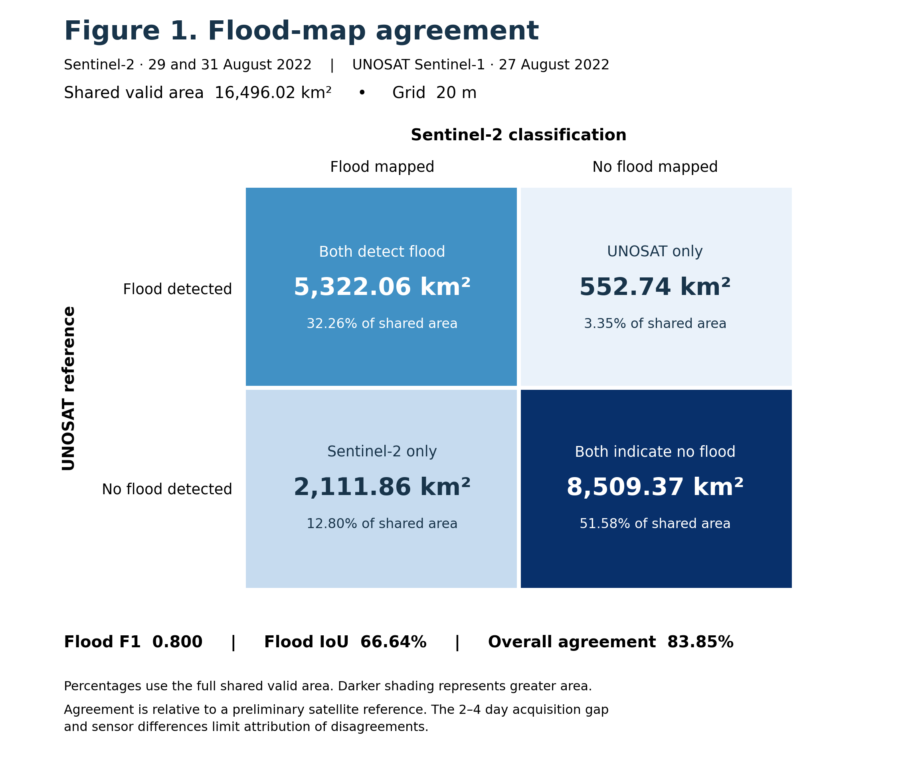
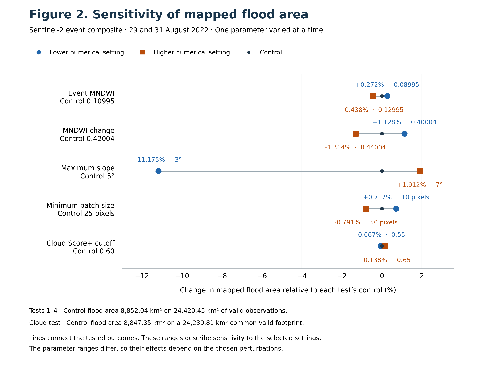
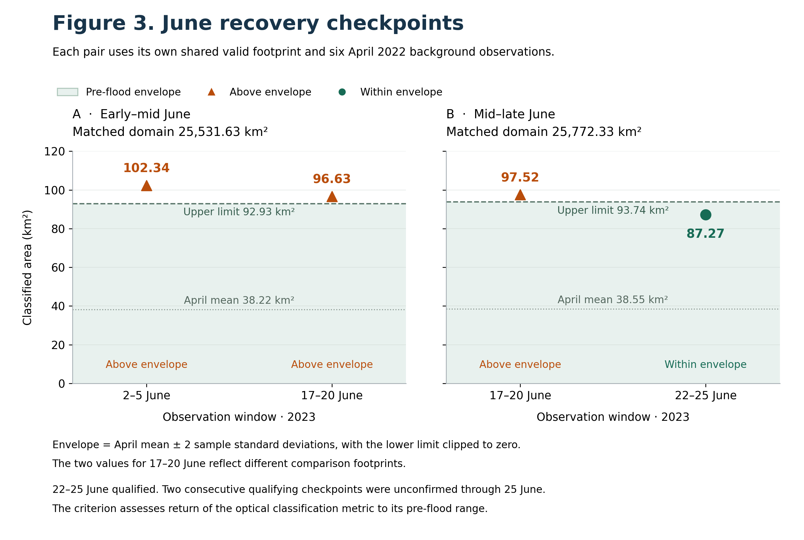

# Pakistan floods · From inundation to recovery

**Satellite flood mapping, reference agreement and June 2023 recovery in the Dadu–Qambar study area, Sindh.**

[](https://github.com/Mohsin-oss/pakistan-flood-2022-satellite-analysis/actions/workflows/checks.yml)


[Results](#explore-the-results) · [Reproduce](#reproduce-the-figures) · [Final interpretation](outputs/stage8_figures/stage8_final_interpretation_and_captions.md) · [Validation record](docs/validation.json)

Sentinel-2 imagery maps candidate inundation, UNOSAT Product 3342 provides an independent satellite reference, and five sensitivity tests assess classification choices. Matched-domain June comparisons assess return to a descriptive pre-flood envelope.

| Shared valid comparison area | Flood F1 | Flood intersection over union |
|:---:|:---:|:---:|
| **16,496.02 km²** | **0.800** | **66.64%** |

## The study in nine stages


The analysis and portfolio publication are complete within the documented study scope.

## Explore the results

<details open>
<summary><strong>01 · How well do the flood maps agree?</strong></summary>



Flood F1 is **0.800** and IoU is **66.64%** over the shared valid footprint. Sentinel-2 observations from 29 and 31 August are compared with UNOSAT's 27 August Sentinel-1 detections. Acquisition timing and sensor differences affect interpretation.

[Agreement metrics](outputs/stage6_3_agreement/agreement_metrics.json) · [Disagreement map](outputs/stage6_4_disagreement/stage6_4_disagreement_map.png)

</details>

<details>
<summary><strong>02 · Which classification choice matters most?</strong></summary>



The slope cutoff produces the largest area change over the settings tested. A 3° limit reduces mapped area by **11.18%** relative to the 5° control. Event MNDWI, change MNDWI, minimum patch size and cloud cutoff have smaller effects over their tested ranges. Cloud comparisons use a common valid domain.

[Five sensitivity exports](outputs/stage7-mndwi)

</details>

<details>
<summary><strong>03 · Had the recovery criterion been met?</strong></summary>



The **22–25 June 2023** checkpoint falls within its matched pre-flood envelope. The requirement for two consecutive qualifying checkpoints remained unmet through 25 June. Each pair has its own shared domain and recalculated April envelope.

[June exports](outputs/stage5_historical) · [Final captions](outputs/stage8_figures/stage8_final_interpretation_and_captions.md)

</details>

## Clean Windows reproduction

A fresh checkout of commit `b84e778a04a39671b679557a092a3f7b8eebc25d` passed the results audit in a newly created Windows Conda environment using Python **3.14.6** and all **eight published dependency versions**. All 72 entries in the published checksum manifest matched before regeneration.

| Regenerated figure | PNG comparison | SVG comparison |
|---|---|---|
| Flood-map agreement | Byte-for-byte identical | Identical after timestamp and generated-ID normalization |
| Five sensitivity tests | Byte-for-byte identical | Identical after timestamp and generated-ID normalization |
| June recovery | Byte-for-byte identical | Identical after timestamp and generated-ID normalization |

The clean run audited recovery, agreement, all five sensitivity tests and spatial cell totals, then regenerated the figures from included CSV/JSON summaries. Conda installed cached packages into a separate environment. The attempted PyPI installation timed out. A successful network-only pip installation and a full raw-input spatial rerun in the new environment remain unverified.

## Reproduce the figures

Clone the repository and enter its directory. The successful Windows run used the following package specifications with cached Conda packages. Fresh online acquisition remains to be checked.

```sh
conda create -n pakistan-flood python=3.14.6 numpy=2.5.3 geopandas-base=1.2.0 shapely=2.2.0 pyproj=3.8.0 pyogrio=0.13.0 rasterio=1.5.2 scipy=1.18.1 matplotlib-base=3.10.9 -c conda-forge
conda activate pakistan-flood
python scripts/verify_results.py
python scripts/stage8_figure01.py
python scripts/stage8_figure02.py
python scripts/stage8_figure03.py
```

<details>
<summary><strong>Alternative pip setup and full spatial reproduction</strong></summary>

The pinned pip requirements are provided. The clean online installation attempt encountered download timeouts.

```sh
python -m venv .venv
# Activate .venv using the command for your shell.
python -m pip install -r requirements.txt
```

The arithmetic audit uses the Python standard library. Full spatial reproduction requires separately acquired inputs. Follow the [workflow and input guide](docs/reproduction.md), including input hashes, geometry repair, grid alignment and valid-footprint masking. Use a separate checkout for experimental reruns to preserve archived results.

</details>

## Repository guide

| Location | Contents |
|---|---|
| [gee/](gee) | Twelve standalone Earth Engine scripts |
| [scripts/](scripts) | Repair, alignment, agreement, disagreement mapping, figures and audit |
| [outputs/](outputs) | Verified summaries, maps, PNG/SVG figures and interpretation |
| [docs/](docs) | Reproduction guide, provenance, input and package checksums |
| [environment.json](environment.json) | Recorded Python and primary library versions |

The 199 MB UNOSAT ZIP, source shapefiles, source GeoTIFF and derived spatial binaries are acquired separately. Their hashes and acquisition steps are documented. The vector repair is specific to the audited UNOSAT archive layout.

## Scientific scope

- UNOSAT is a preliminary satellite reference acquired 2–4 days before the optical composite. Agreement covers the shared valid footprint.
- Recovery describes the optical classification metric. One-at-a-time sensitivity tests do not estimate total uncertainty.
- Stage 1–5 and fixed-grid Stage 6–7 classifiers differ. Their event areas require their own methods and domains.
- The May first-return claim remains provisional because its export is missing. Verified June exports support Figure 3.
- The **0.1412 km²** Stage 6/7 control difference remains unresolved at the pixel level.

## Licensing

A project-wide code license has not yet been adopted. UNOSAT and satellite products retain their source terms. Review redistribution terms before adding third-party source or derived geospatial data.
